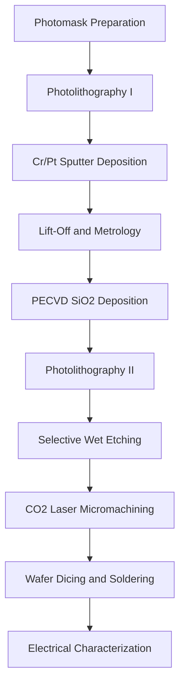

# Platinum Four-Electrode Conductivity Sensor

### Semiconductor Microfabrication & Process Characterization

**University of Utah | Utah Nanofab | Fall 2025**


**[Microfabrication](#fabrication-process-flow)** |
**[PVD](#3-physical-vapor-deposition-pvd)** |
**[PECVD](#5-plasma-enhanced-chemical-vapor-deposition-pecvd)** |
**[Metrology](#fabrication-and-metrology-equipment)** |
**[Electrical Testing](#10-electrical-characterization)**


## Project Overview

Fabrication and electrical characterization of a four-electrode
platinum conductivity flow chip for measuring liquid electrolyte
conductivity in conjunction with infrared spectroscopy.

The project involved a ten-stage cleanroom fabrication workflow,
including photolithography, thin-film deposition, lift-off,
dielectric insulation, wet etching, laser micromachining,
wafer dicing, and electrical characterization.

## Project Objectives

- Fabricate patterned platinum thin-film electrodes.
- Implement a two-mask photolithography process.
- Deposit and characterize metallic and dielectric thin films.
- Evaluate fabricated feature dimensions against design targets.
- Integrate electrolyte inlet and outlet ports.
- Validate device functionality through electrical measurements.

## Key Engineering Results

| Parameter | Result |
|---|---|
| Wafer diameter | 4 inches |
| Photolithography masks | 2 |
| Target chromium thickness | 10 nm |
| Target platinum thickness | 50 nm |
| Target electrode linewidth | 200 µm |
| Measured electrode linewidth | 197.6–197.7 µm |
| Linewidth deviation from target | 1.15–1.20% |
| PECVD SiO₂ thickness range | 233.9–238.8 nm |
| Oxide thickness measurement locations | 5 |
| Laser-machined hole diameter | Approximately 858–901 µm |
| Electrical characterization | Four-electrode EIS |
| Device validation | Linear conductance–conductivity response |

## Fabrication Process Flow



## 1. Photomask Preparation

A two-mask process was used to define the platinum electrode
geometry and selectively expose electrode regions through
the dielectric insulation.

- Mask 1: Platinum electrodes and interconnects.
- Mask 2: SiO₂ insulation openings.
- Equipment: Heidelberg MicroPG 101 pattern generator.
- Mask substrate: Chrome-on-glass.
- Laser wavelength: 405 nm.

## 2. Photolithography 

Positive photoresist processing was used to define
the initial electrode and interconnect patterns.

| Process Parameter | Value |
|---|---|
| Photoresist | S1813 |
| Spin speed | 3,000 rpm |
| Spin duration | 60 seconds |
| Soft-bake temperature | 110°C |
| Soft-bake duration | 60 seconds |
| Developer | AZ 1:1 |
| Exposure method | Hard-contact lithography |

Optical microscopy and thin-film metrology were used
to examine the developed photoresist patterns.

## 3. Physical Vapor Deposition (PVD)

Chromium and platinum thin films were deposited using
the Denton 635 sputtering system.

| Material | Target Thickness | Function |
|---|---:|---|
| Chromium (Cr) | 10 nm | Adhesion layer |
| Platinum (Pt) | 50 nm | Conductive electrode |

The chromium adhesion layer improves metal adhesion
to the glass substrate.

Metal film characterization involved stylus profilometry
and optical inspection.

## 4. Lift-Off and Dimensional Metrology

Following metal deposition, the photoresist was removed
to reveal the patterned platinum electrodes.

### Linewidth Analysis

| Parameter | Value |
|---|---:|
| Design linewidth | 200 µm |
| Measured linewidth 1 | 197.6 µm |
| Measured linewidth 2 | 197.7 µm |
| Mean measured linewidth | 197.65 µm |
| Mean absolute deviation | 2.35 µm |
| Mean percentage deviation | 1.175% |

The measured electrode linewidths were within 1.2%
of the nominal design target at the inspected locations.

This characterization demonstrates dimensional comparison
between designed and fabricated features.

## 5. Plasma-Enhanced Chemical Vapor Deposition (PECVD)

A silicon dioxide dielectric layer was deposited to
electrically isolate the platinum interconnects from
the electrolyte.

| Process Parameter | Value |
|---|---|
| Equipment | Oxford PlasmaPro PECVD |
| Dielectric material | SiO₂ |
| Deposition temperature | 400°C |
| Chamber pressure | 900 mTorr |
| Measurement locations | 5 |
| Measured thickness range | 233.9–238.8 nm |

Film thickness measurements were collected at five
locations to evaluate spatial thickness variation.

The measured thickness range was 4.9 nm.

## 6. Photolithography II

A second photolithography process aligned the oxide
opening pattern with the previously fabricated
platinum electrode geometry.

Key process considerations:

- Mask-to-mask alignment.
- Pattern registration.
- Photoresist development.
- Electrode opening dimensions.
- Protection of underlying interconnects.

Measured opening widths included 197.9 µm and 202 µm.

## 7. Selective Wet Etching

Selective oxide wet etching was used to expose
the required platinum electrode regions while
retaining dielectric insulation over the interconnects.

The patterned dielectric provided electrical isolation
between the electrolyte and protected metal wiring.

## 8. Laser Micromachining

Electrolyte inlet and outlet holes were fabricated
using a Universal Laser PLS6.150D CO₂ laser system.

- Nominal hole diameter: 1 mm.
- Measured diameters: Approximately 858–901 µm.
- Purpose: Enable electrolyte flow through the device.

The dimensional difference between the nominal and
fabricated hole diameters represents an opportunity
for further process characterization and optimization.

## 9. Wafer Dicing and Electrical Integration

The fabricated wafer was separated into individual
devices using the Disco DAD641 dicing system.

Electrical connections were established through
soldered contacts to the platinum contact pads,
preparing the device for electrical characterization.

## 10. Electrical Characterization

The fabricated device was characterized using
four-electrode Electrochemical Impedance
Spectroscopy (EIS).

### Test Equipment

- Gamry Interface 1000E potentiostat.
- Four-electrode conductivity measurement configuration.
- Electrolyte conductivity calibration.

### Measurement Principle

The outer electrodes provide electrical excitation,
while the inner electrodes measure the potential
difference across the electrolyte.

The four-electrode configuration helps reduce
the influence of electrode polarization on
conductivity measurements.

### Results

Electrical characterization demonstrated a linear
relationship between measured conductance and
electrolyte conductivity over the tested calibration
conditions, confirming functional device operation.

## Fabrication and Metrology Equipment

| Equipment | Application |
|---|---|
| Heidelberg MicroPG 101 | Photomask preparation |
| SUSS Contact Aligner | Photolithography and alignment |
| Denton 635 | PVD sputter deposition |
| Nanospec 3000 | Optical film thickness measurement |
| Tencor P-20H | Stylus profilometry |
| Oxford PlasmaPro PECVD | Dielectric deposition |
| Optical Microscope | Dimensional metrology |
| Universal Laser PLS6.150D | Laser micromachining |
| Disco DAD641 | Wafer dicing |
| Gamry Interface 1000E | Electrical characterization |

Equipment listed represents tools used or demonstrated
during the academic laboratory workflow.

## Process Engineering and Data Analysis

The fabrication results were evaluated using:

- Design-to-fabrication dimensional comparison.
- Thin-film thickness characterization.
- Percentage deviation analysis.
- Spatial thickness variation analysis.
- Optical inspection.
- Electrical calibration analysis.
- Process documentation.

### Linewidth Deviation

The percentage deviation was calculated using:

```
Deviation (%) = |Measured - Target| / Target × 100
```

For the mean measured electrode linewidth:

```
Target linewidth   = 200 µm
Measured linewidth = 197.65 µm
Absolute deviation = 2.35 µm
Percentage error   = 1.175%
```

## Process Improvement Opportunities

Potential areas for further investigation include:

- Optimization of laser-machined hole dimensions.
- Evaluation of photoresist thickness uniformity.
- Improvement of mask alignment accuracy.
- Investigation of sputtered film thickness discrepancies.
- Expanded dielectric thickness sampling.
- Additional calibration and repeatability testing.

These are proposed improvements rather than completed
process optimization experiments.

## Technical Skills Demonstrated

- Semiconductor microfabrication
- Cleanroom processing
- Photolithography
- Photomask alignment
- Physical Vapor Deposition (PVD)
- Plasma-Enhanced Chemical Vapor Deposition (PECVD)
- Thin-film characterization
- Selective wet etching
- Lift-off patterning
- Optical microscopy
- Profilometry
- Dimensional metrology
- Laser micromachining
- Wafer dicing
- Electrical characterization
- Experimental data analysis
- Process documentation

## Repository Structure

```
platinum-conductivity-sensor-microfabrication/
│
├── README.md
├── data/
├── docs/
└── scripts/
```

## Data Quality and Limitations

This project represents an academic microfabrication
workflow rather than a production-qualified
semiconductor manufacturing process.

Reported deposition targets are distinguished from
measured dimensions and film thicknesses.

The project report contains discrepancies in the
reported substrate terminology, metal thickness units,
and oxide thickness statistics. These require verification
against original laboratory measurement records.

The available calibration results demonstrate device
functionality but do not establish manufacturing yield,
process capability, or long-term measurement repeatability.

## References and Acknowledgements

- University of Utah — Department of Electrical and
  Computer Engineering
- Utah Nanofab
- Micromachining Laboratory — Fall 2025
- [Utah Nanofab](https://www.nanofab.utah.edu/)
- [Gamry Instruments](https://www.gamry.com/)

This project was completed as part of the University
of Utah Micromachining Laboratory coursework with
guidance from laboratory instructors and teaching assistants.

## Author

**Chakradhar Sai Ananthagiri**

Master of Science — Electrical and Computer Engineering  
University of Utah, Salt Lake City, USA

- [LinkedIn](https://www.linkedin.com/in/chakradhar-sai)
- [GitHub](https://github.com/Chakri1512)
