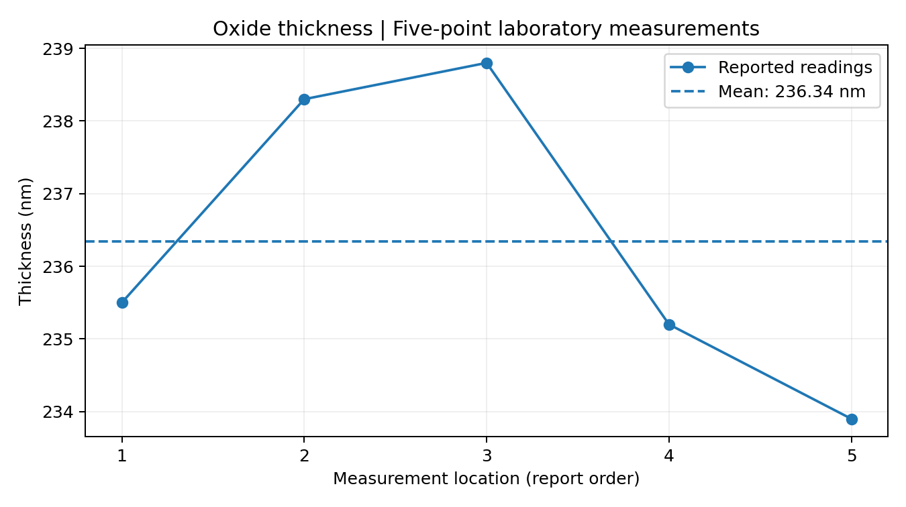
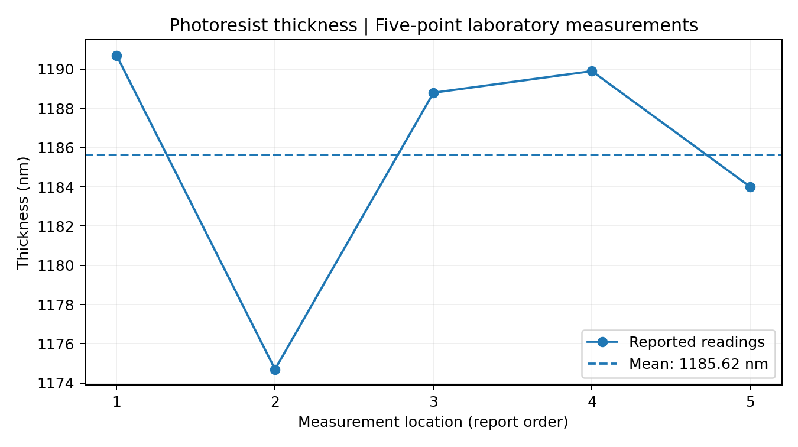
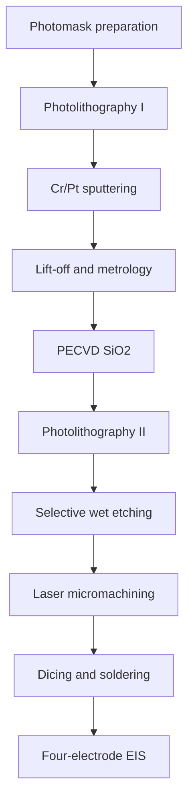

# Platinum Four-Electrode Conductivity Sensor

**Microfabrication & Process Characterization | University of Utah, Utah Nanofab | Fall 2025**

Academic cleanroom project to fabricate a four-electrode platinum flow chip for electrolyte conductivity measurements alongside infrared spectroscopy. The laboratory workflow combines two-mask lithography, metal and dielectric deposition, selective etching, device assembly and electrical testing.

[Process flow](#fabrication-workflow) · [Measured results](#measured-results) · [Data analysis](#reproduce-the-analysis) · [Technical documentation](#technical-documentation)

## Measured results

| Metric | Result | Engineering interpretation |
|---|---|---|
| Pt linewidth | 197.6–197.7 µm | 1.15–1.20% below 200 µm nominal at two inspected features |
| PECVD SiO₂ thickness | 236.34 ± 2.11 nm (mean ± sample SD, n=5) | 233.9–238.8 nm measured range |
| S1813 resist thickness | 1185.62 ± 6.64 nm (n=5) | 16.0 nm measured range |
| Oxide opening widths | 197.9 and 202 µm | Compared with 200 µm nominal |
| Laser-machined ports | 856.9–908.2 µm across four measured axes | 9.18–14.31% below 1 mm nominal |
| Electrical validation | Linear conductance–conductivity response reported | Functional validation, not repeatability or production yield |

The thickness statistics were recalculated from the final laboratory report for this portfolio. See [data quality notes](docs/data-quality.md) for discrepancies and source limitations.

## Experimental process characterization

### PECVD oxide thickness



### Photoresist thickness



## Fabrication workflow



The nominal metal stack was 10 nm Cr / 50 nm Pt. The four-inch glass wafer was patterned using two masks; the second mask exposed electrode regions while retaining dielectric insulation over wiring. Final EIS testing used a Gamry Interface 1000E with 10 mV RMS excitation over 1 Hz–100 kHz.

## Process engineering interpretation

The laser ports were consistently below nominal across the four reported axes. A useful follow-up would be to verify dimensional calibration and compare laser process conditions under supervised trials. Additional wafer sampling would be needed to evaluate thickness stability. These are proposed investigations, not completed optimization or yield-improvement experiments.

## Reproduce the analysis

From the repository root, using Python 3:

```bash
python -m pip install -r requirements.txt
python scripts/analyze_process.py
```

The script reads the CSV measurements, computes descriptive statistics and regenerates the two thickness plots. It is a retrospective portfolio analysis, not original instrument software.

## Technical documentation

- [Detailed fabrication methods and equipment](docs/fabrication-methods.md)
- [Ten-stage process and equipment summary](docs/process-flow.md)
- [Process results and engineering interpretation](docs/process-results.md)
- [Data quality and limitations](docs/data-quality.md)
- [Oxide thickness data](data/oxide_thickness.csv)
- [Photoresist thickness data](data/photoresist_thickness.csv)
- [Dimensional metrology data](data/dimensional_metrology.csv)
- [Python analysis](scripts/analyze_process.py)

## Scope and acknowledgements

This is an academic laboratory project, not a production-qualified semiconductor process. Equipment names identify tools used or demonstrated in the course, not independent operator certification. The final report acknowledges laboratory instructors, Utah Nanofab staff and labmates who contributed figures and data. The measurements here summarize reported laboratory results; individual contributions and permission for public redistribution should be confirmed. Raw EIS data are unavailable here. No yield, process capability or long-term repeatability claims are made.

## Author

**Chakradhar Sai Ananthagiri** — M.S. Electrical and Computer Engineering, University of Utah

[LinkedIn](https://www.linkedin.com/in/chakradhar-sai) · [GitHub](https://github.com/Chakri1512) · [Utah Nanofab](https://www.nanofab.utah.edu/)
